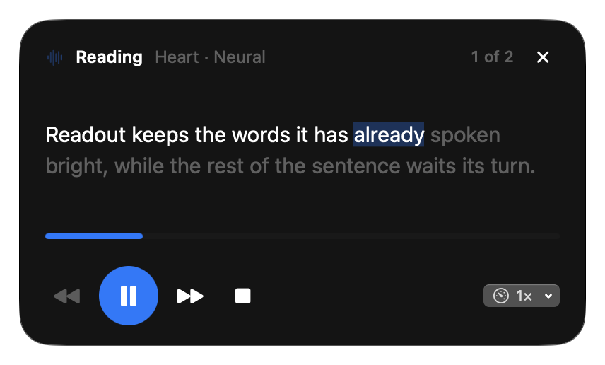
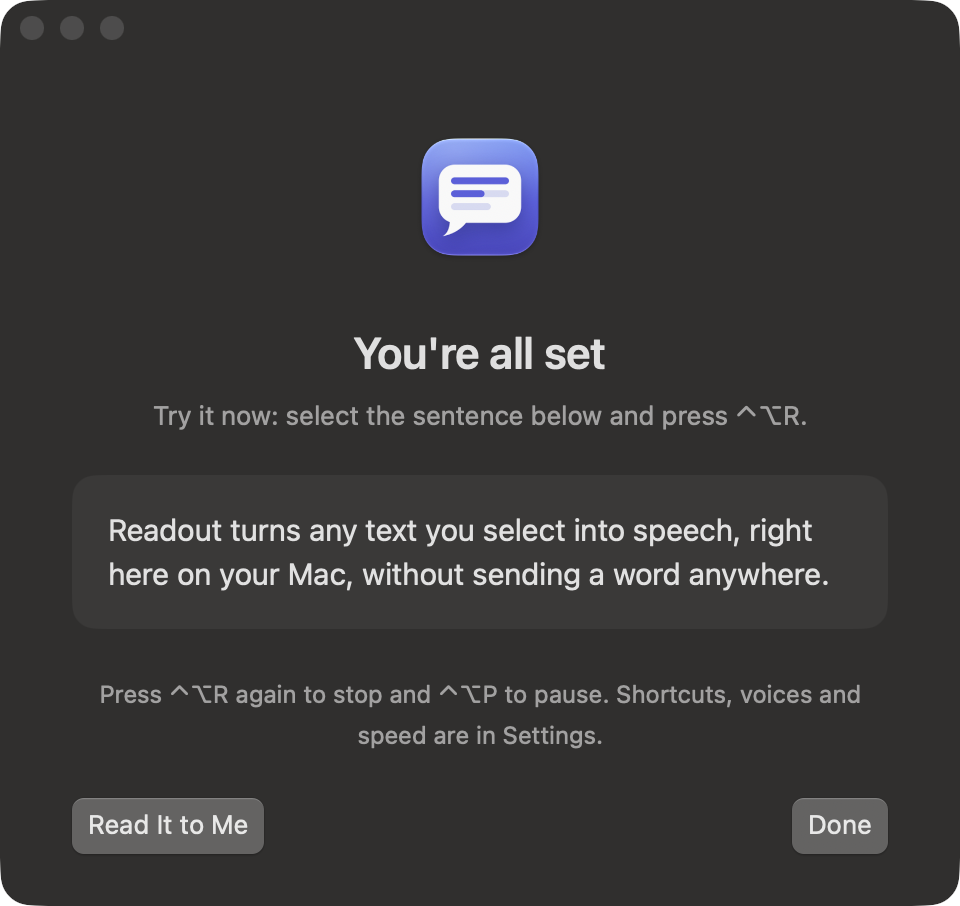
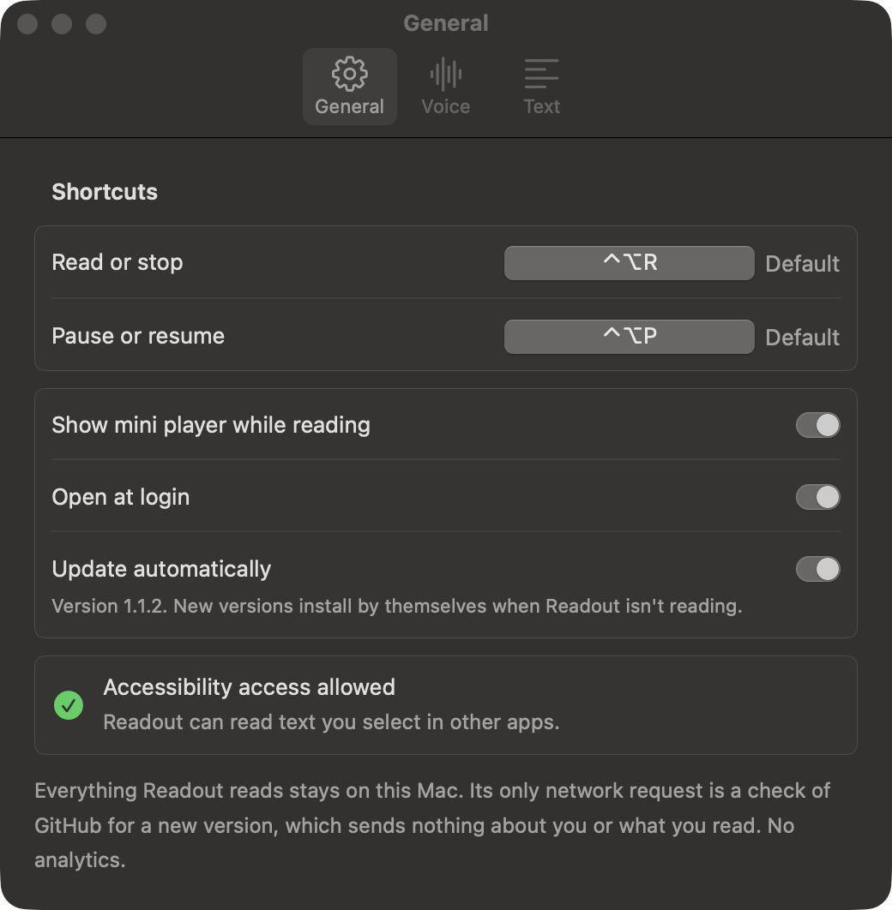
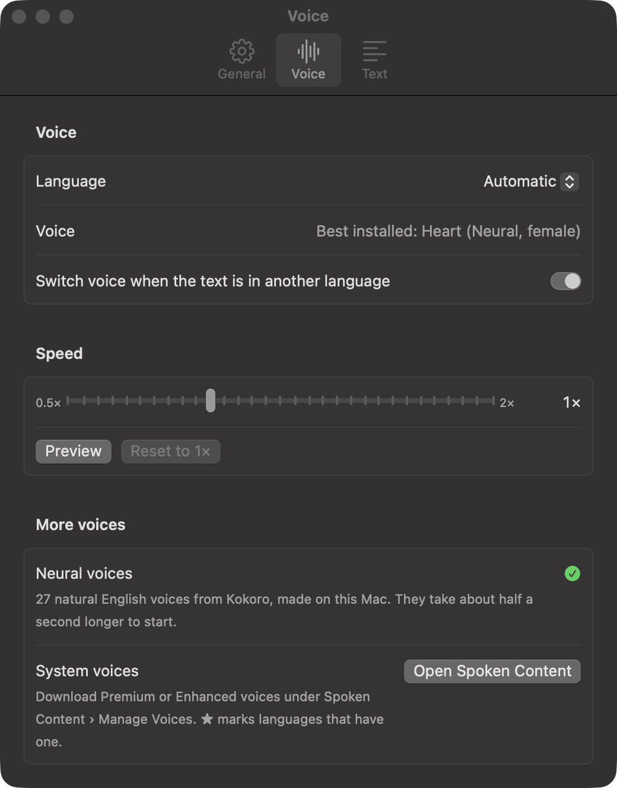
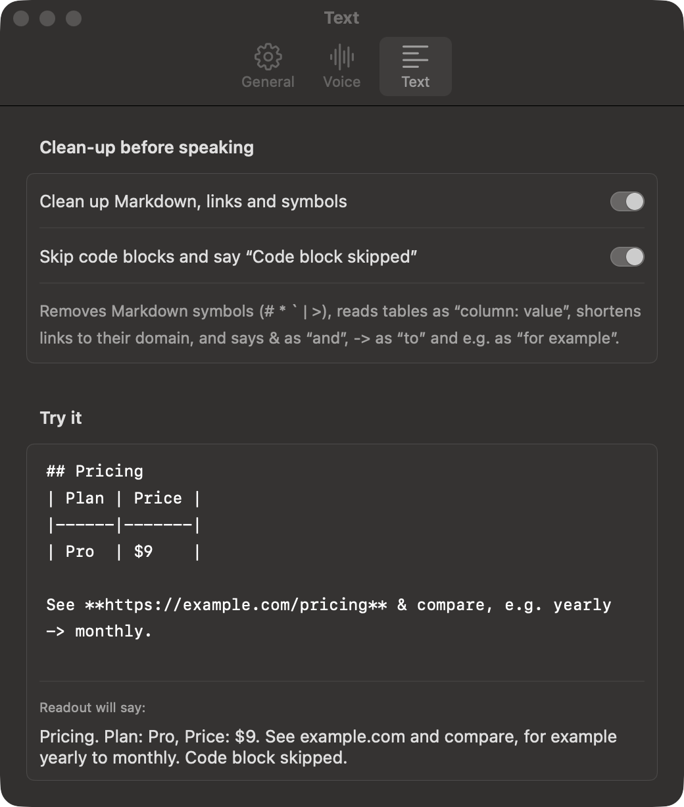

# Readout

**Select text in any app, press ⌃⌥R, and your Mac reads it aloud.**

Readout is a small menu bar app for macOS. It reads only what you select, in Safari, Chrome, Notes,
Slack, a PDF or anywhere else, with the Mac's own voices or with optional neural voices that sound
close to a real person. Everything runs on your Mac.

<p align="center">
  
</p>

- **Works in any app.** Readout reads the selection through macOS Accessibility. In apps that don't
  share it (most browsers and Electron apps), it copies the selection for a moment and then puts
  your clipboard back exactly as it was.
- **Starts at once, stops at once.** Long selections start speaking almost immediately, and
  pressing ⌃⌥R again stops within milliseconds.
- **Reads Markdown properly.** Tables become sentences, code blocks are skipped, and links are
  read as their domain instead of as symbols.
- **A mini player you can steer.** Words fill in as they're spoken. Click the progress track to
  jump, skip a sentence back or forward, and change the speed without losing your place.
- **Private.** Nothing you read leaves your Mac. The only network request is a check for updates.

## Install

On a Mac with Apple silicon running macOS 14 or later, paste this into Terminal:

```bash
curl -fsSL https://raw.githubusercontent.com/MuhammadAmas/Readout/main/install.sh | bash
```

To also get the natural-sounding neural voices (a one-time 360 MB download):

```bash
curl -fsSL https://raw.githubusercontent.com/MuhammadAmas/Readout/main/install.sh | bash -s -- --with-neural-voice
```

The installer downloads the latest [release](https://github.com/MuhammadAmas/Readout/releases),
checks its SHA-256, puts `Readout.app` in `/Applications` (or `~/Applications` if you can't write to
`/Applications`), and opens it. After that, Readout keeps itself up to date (see
[Updates](#updates)).

On an Intel Mac, [build it from source](#build-from-source) instead. Readout has been tested on
macOS 27.2.

## First launch: allow Accessibility

Readout needs Accessibility access to see the text you select in other apps. The welcome window
walks you through it:

1. Click **Open Accessibility Settings**. Readout adds itself to the list in System Settings
   (Privacy & Security › Accessibility; newer macOS versions call it *Device Control and Data
   Access*).
2. Turn on **Readout**, entering your password if asked.
3. Switch back. The window notices by itself and shows **You're all set**.
4. Select the sample sentence and press **⌃⌥R** to try it, or click **Read It to Me**. Then click
   **Done**.

<p align="center">
  
</p>

If you click **Not Now**, you can come back to this later from the menu bar icon (**Allow
Accessibility Access…**).

## Everyday use

| Shortcut | What it does |
| --- | --- |
| **⌃⌥R** (Control-Option-R) | Read the selected text. Press again to stop. |
| **⌃⌥P** (Control-Option-P) | Pause or resume. |

Both shortcuts work in every app, and you can change them in **Settings › General**: click a
shortcut, then press the new combination, which must include ⌃, ⌥ or ⌘. While recording, **Esc**
cancels, **Delete** clears the shortcut and **Default** restores it.

While Readout is reading, the **mini player** floats in a corner of the screen:

- Spoken words turn bright and the current word is highlighted.
- The track under the text shows how far through the selection you are. Click it to jump to that
  part.
- The buttons go back a sentence, pause or resume, go forward a sentence, and stop. The speed menu
  on the right changes speed on the fly.
- Drag the player anywhere; it remembers its place. **✕** hides it while reading continues, and
  **Show Mini Player** in the menu brings it back. To turn it off, use **Settings › General ›
  Show mini player while reading**.

Readout has no Dock icon. It lives in the menu bar (a speech-bubble icon), whose menu has
**Read Selection**, **Pause**/**Resume**, **Stop**, **Show Mini Player**, **Settings…**, **About
Readout** and **Quit Readout**. Opening Readout from Applications or Spotlight also brings up its
Settings window. To start it automatically, turn on **Settings › General › Open at login**.

<p align="center">
  
</p>

## Voices and speed

**Settings › Voice** picks the voice and speed.

- **Language** and **Voice** list every installed voice, grouped by language, best first. **Automatic**
  uses the best voice installed for your Mac's language.
- **Switch voice when the text is in another language** detects the selection's language and uses
  the best voice installed for it.
- **Speed** runs from 0.5× to 2×. **Preview** plays a sample. If you change speed while Readout is
  reading, it carries on from where it is: neural voices change speed instantly, mid-word, and
  system voices pick up again at the word being spoken.

<p align="center">
  
</p>

### Better voices

The voices macOS installs by default sound robotic. There are two ways to get better ones, both
offline:

- **Neural voices (recommended).** 27 English voices (US and UK accents) from the open
  [Kokoro](https://huggingface.co/hexgrad/Kokoro-82M) model, generated on your Mac. Install them
  with the `--with-neural-voice` command under [Install](#install), or with **Copy Command** under
  **Settings › Voice › More voices** (paste it into Terminal). Once they're installed, Automatic
  uses *Heart*, and the voice list marks them *(Neural)*.
- **Premium or Enhanced system voices.** In System Settings › Accessibility › Spoken Content, choose
  **Manage Voices…** from the System Voice menu and download one, for example *Ava (Premium)*.
  Readout lists it as soon as the download finishes. **Open Spoken Content** in Settings takes you
  there.

Neural voices take about half a second longer to start than system voices, and they read English
only; text in other languages falls back to the system voices.

## What it reads aloud cleanly

**Settings › Text** cleans up text before speaking. It's on by default, and the **Try it** box shows
exactly what will be said.

| You select | Readout says |
| --- | --- |
| `# Heading`, `**bold**`, `*italic*`, `` `code` ``, `> quote`, `- item` | the words, without the symbols |
| A Markdown table | one sentence per row: "Name: Alice, Age: 30." |
| A fenced code block | "Code block skipped." (or the code itself, if you turn skipping off) |
| `https://www.example.com/a/b?c=d` | "example.com" |
| `[the docs](https://…)` | "the docs" |
| `&`, `->`, `→` | "and", "to", "to" |
| `e.g.`, `i.e.`, `etc.`, `vs.` | "for example", "that is", "et cetera", "versus" |
| A line break in the middle of a sentence (common in PDFs) | one sentence, with split words such as "infor-mation" rejoined |

<p align="center">
  
</p>

## Updates

Readout updates itself. About a minute after it starts, and every six hours while it runs, it checks
GitHub for a newer release. When there is one, it:

1. downloads it and checks its SHA-256,
2. checks that the new app is signed by the same certificate as the one you're running, so a
   tampered download is refused even if its checksum was forged too,
3. waits until it isn't reading, replaces itself, relaunches, and shows "Readout updated to …".

Your settings, shortcuts, voices and Accessibility access carry over. You can turn this off in
**Settings › General › Update automatically**. Running the install command again also updates
Readout.

Only a copy in `/Applications` or `~/Applications` updates itself. Version 1.0.0 predates the
updater, so a 1.0.0 install needs the install command run once more; after that it updates itself.

## Privacy

- The text you select is processed on your Mac and never sent anywhere. Readout doesn't save it.
- The only network request is the update check described above. It sends nothing but a
  `Readout/<version>` user agent.
- No analytics, no accounts, no tracking.
- The neural voices are downloaded once, by the install command, from the
  [sherpa-onnx releases](https://github.com/k2-fsa/sherpa-onnx/releases) on GitHub. After that they
  run offline.

## Troubleshooting

**Readout doesn't seem to open.** Readout has no Dock icon, so once setup is done it lives only in
the menu bar. On a Mac with a notch or a crowded menu bar, macOS may hide its icon. Readout 1.1.1 and
later show the Settings window whenever you open the app. On an older copy, check whether
**Readout** is listed in Activity Monitor; if it is, it's running and ⌃⌥R works. Updating with the
install command fixes it for good.

**Accessibility is turned on, but Readout still asks for it.** macOS tracks permission per app
signature, so a copy built or signed differently counts as a new app. In the Accessibility list,
select **Readout**, remove it with **−**, then click **Open Accessibility Settings** in Readout
and turn it on again.

**"Nothing selected" appears.** Readout couldn't get any text: nothing was selected, the app blocks
copying, or the text isn't really text (a scanned PDF, a remote desktop window). See
[Known limitations](#known-limitations).

**The neural voices aren't listed.** Check **Settings › Voice › More voices**. If it says the voices
aren't installed, click **Copy Command**, paste it into Terminal, then close and reopen Settings.

## Uninstall

Turn off **Settings › General › Open at login** first if you turned it on. Then quit Readout and
run:

```bash
rm -rf /Applications/Readout.app ~/Applications/Readout.app
rm -rf ~/Library/Application\ Support/Readout
defaults delete dev.readout.Readout
```

The second line removes the neural voices and the third removes your settings. Finally, remove
Readout from the Accessibility list in System Settings with **−**.

## Known limitations

- **Copying fallback.** Chrome, Arc, Brave, Edge, Firefox and Electron apps (Slack, VS Code,
  Discord, Notion, Obsidian) don't share their selection with Accessibility, so Readout copies it.
  That adds roughly 50–150 ms.
- **Where copying doesn't work, nothing can be read:** remote desktop and virtual machine windows,
  pages that block copying, apps that remap ⌘C, terminal programs that capture the mouse, text
  drawn as graphics, and scanned PDFs without a text layer.
- **Password fields** are never read.
- **Clipboard managers** (Maccy, Raycast, Paste and others) may save the temporary copy in their
  history, even though your clipboard itself is restored exactly.
- **Keyboard layouts that switch to QWERTY while ⌘ is held** ("Dvorak – QWERTY ⌘") can make the
  copy step press the wrong key. Other layouts, including Dvorak, AZERTY and non-Latin ones, work.
- **Languages need an installed voice.** macOS has no Urdu voice, for example, so Urdu text is read
  by your chosen voice, which can't pronounce it. Neural voices are English only.
- **Neural voices use memory:** about 680 MB while loaded. Readout loads them at launch and releases
  them after 15 minutes without reading.
- **The neural word highlight is estimated** from playback time, so it can be a word ahead or
  behind. System voices report exact word timings.
- **Apple silicon only** for the prebuilt app. The app isn't notarized by Apple: installing with the
  command works without a warning, but opening a downloaded zip from a browser triggers Gatekeeper.

---

## For developers

### Build from source

You need macOS 14 or later and Swift 5.9 or later. The Command Line Tools are enough; full Xcode is
optional.

```bash
git clone https://github.com/MuhammadAmas/Readout.git
cd Readout
scripts/create-signing-identity.sh   # once: a local signing certificate (see below)
make install                         # build and copy Readout.app to /Applications
```

| Command | What it does |
| --- | --- |
| `make build` | debug build with SwiftPM |
| `make test` | unit tests: text clean-up, sentence splitting, language detection, reading queue |
| `make app` | release build, wrapped as `build/Readout.app` and signed |
| `make run` | `make app`, then open it |
| `make install` | `make app`, then copy it to `/Applications` |
| `make selftest` | timing, stop, clipboard, neural voice and speed-change checks against the real engines |
| `make neural-voice` | download the Kokoro voices into `~/Library/Application Support/Readout/Neural` |
| `make release` | package `dist/Readout.zip` and its SHA-256, and print the `gh release create` command |
| `make icon` | redraw `Resources/AppIcon.icns` from `scripts/make-icon.swift` |
| `make clean` | delete `.build`, `build` and `dist` |

`Package.swift` is the project file; open it in Xcode to browse and debug with the `Readout` scheme.
To run the app for real, use `make app`, which adds the `Info.plist` that makes Readout a menu bar app.

### Signing

macOS ties Accessibility access to the app's code signature, and the updater only accepts releases
signed by the same certificate. `scripts/create-signing-identity.sh` creates a self-signed,
code-signing-only certificate named "Readout Local Signing" in your login keychain, valid for 10
years. It isn't trusted system-wide, and it doesn't need to be. `make app` uses it automatically and
prints which identity it signed with. The designated requirement then stays
`identifier "dev.readout.Readout" and certificate leaf = H"…"` across builds, so permission
survives rebuilds.

- Without the certificate, builds are ad-hoc signed, and Accessibility has to be granted again
  after every build.
- To sign with another identity, such as a Developer ID, set `SIGN_IDENTITY="…"`.
- If a build seems to hang at `codesign`, macOS is asking for your login password to unlock the
  key. Enter it and choose **Always Allow**.
- Back the certificate up (export it from Keychain Access). Without it you can't publish updates
  that installed copies will accept.

### Releasing

1. Raise `CFBundleShortVersionString` (and `CFBundleVersion`) in `Resources/Info.plist`, then commit
   and push.
2. Run `make release` from a clean checkout.
3. Run the `gh release create` command it prints.

The install command always fetches the latest release, and installed copies pick it up within six
hours.

### Building without Xcode

`scripts/toolchain.sh` makes the Command Line Tools work:

- From the macOS 27 SDK onwards, SwiftUI's `@State` is a macro whose plugin ships only with Xcode.
  Without Xcode, the script builds against the newest installed SDK where `@State` is still a
  property wrapper (26.5 on the Mac this was built on).
- It passes the Swift Testing macro plugin path explicitly, because SwiftPM doesn't always find it.

With full Xcode installed, the script steps aside.

### Project layout

```
Readout/
  App/              entry point, app model, preferences, self-test, updater, logging
  Hotkeys/          shortcut names and the shortcut recorder
  Selection/        Accessibility selection, the ⌘C fallback, clipboard snapshot and restore
  Speech/Core/      SpeechEngine protocol, ReadingQueue, SentenceSplitter, LanguageDetector
  Speech/Engines/   system voices, Kokoro neural voices, the router between them, voice catalogue
  Speech/CSherpaOnnx/ the sherpa-onnx v1.13.8 C header (types only; the library is loaded at runtime)
  TextCleanup/      Markdown, table, code, URL and symbol clean-up
  UI/               menu, settings, onboarding, mini player, HUD
Tests/              unit tests for the ReadoutCore target
Resources/          Info.plist and the app icon
scripts/            toolchain, build, release, signing, neural voice download, icon
docs/screenshots/   the images in this README
install.sh          the one-command installer
```

`TextCleanup` and `Speech/Core` make up the `ReadoutCore` target, which has no AppKit dependency and
is covered by unit tests.

### Adding a speech engine

Implement `SpeechEngine` (`Readout/Speech/Core/SpeechEngine.swift`), send its voices to it from
`RoutingSpeechEngine`, and list them in `VoiceCatalog`. `NeuralSpeechEngine` is a worked example.
The reading queue hands the engine one sentence at a time, with one queued ahead, and expects it to:

- call the delegate on the main actor: `didStart` when a sentence begins, `willSpeak` with word
  ranges if it has them, and `didFinish` when the sentence ends;
- send no callbacks for anything queued before a `stop()`;
- apply `pause()` and `resume()` to whatever is playing;
- return `true` from `changeRate(to:)` only if it can change speed without restarting. Otherwise the
  queue restarts at the current word, sending the rest of the sentence with its `textOffset`.

The queue handles skipping, jumping, speed and voice changes, the end of the text, and stale
callbacks.

### Neural voice internals

Kokoro runs through the [sherpa-onnx](https://github.com/k2-fsa/sherpa-onnx) runtime, which Readout
loads with `dlopen` from `~/Library/Application Support/Readout/Neural`. So Readout builds and runs
the same with or without it. `scripts/fetch-neural-voice.sh` downloads and SHA-256-checks:

| File | Size | Contents |
| --- | --- | --- |
| `sherpa-onnx-v1.13.8-osx-universal2-shared-lib.tar.bz2` | 18 MB | the sherpa-onnx and ONNX Runtime libraries |
| `kokoro-multi-lang-v1_0.tar.bz2` | 334 MB | the Kokoro v1.0 model, voices, lexicons and espeak-ng data |

- **Rendering speed:** Kokoro renders a sentence in about a fifth of the time it takes to say. The
  next sentence renders while the current one plays, and the first clause of a long opening
  sentence is rendered on its own so speech starts sooner.
- **Speed changes:** audio is rendered at normal speed and played through `AVAudioUnitTimePitch`,
  which is why speed changes are instant.
- **Why not sherpa-onnx 2.0:** it dropped the espeak-ng fallback and silently skips any word missing
  from its lexicon, even "selected". 1.13.8 pronounces every word.

Measured with `--self-test` on an Apple silicon Mac running macOS 27.2:

| | System voice | Neural voice |
| --- | --- | --- |
| Selection to first audio | 35–76 ms | 0.6–0.9 s (up to 1.7 s when the Mac is busy) |
| Stop | 2–3 ms | 1 ms |
| Clean up and split 5,000 words | 25–31 ms | 25–31 ms |

### Developer options

```bash
build/Readout.app/Contents/MacOS/Readout --self-test              # print PASS/FAIL checks, then quit
open -W build/Readout.app --args --self-test --report /tmp/r.txt  # same, launched like a normal app
open build/Readout.app --args --read "Text to speak"              # read the given text on launch
open build/Readout.app --args --settings                          # open Settings on launch
open build/Readout.app --args --onboarding                        # open the welcome window on launch
READOUT_RELEASE_URL="file://$PWD/dist" bash install.sh            # test the installer against make release
READOUT_UPDATE_FEED="file:///path/latest.json" /Applications/Readout.app/Contents/MacOS/Readout
                                                                  # test self-update against a local release JSON
```

Run the self-test with `open -W …` to check Accessibility. Launched directly from Terminal, macOS
checks Terminal's permission instead of Readout's.

### Dependency notes

- **KeyboardShortcuts is pinned to 1.15.0.** Later versions use `#Preview`, which needs full Xcode to
  compile.
- **Readout has its own shortcut recorder** instead of `KeyboardShortcuts.Recorder`. The recorder's
  localisation bundle would have to sit at the root of the `.app`, which `codesign` rejects.

With full Xcode, both can be revisited.

## Licence

Readout is released under the [MIT licence](LICENSE).

It builds on other people's work, each under its own licence:

- [KeyboardShortcuts](https://github.com/sindresorhus/KeyboardShortcuts) and
  [LaunchAtLogin-Modern](https://github.com/sindresorhus/LaunchAtLogin-Modern) (MIT), Swift packages
  fetched at build time.
- `Readout/Speech/CSherpaOnnx/include/sherpa-onnx-c-api.h`, from
  [sherpa-onnx](https://github.com/k2-fsa/sherpa-onnx) (Apache-2.0), included unchanged.
- The neural voice download, which isn't part of this repository: the sherpa-onnx and ONNX Runtime
  libraries (Apache-2.0 and MIT), the [Kokoro-82M](https://huggingface.co/hexgrad/Kokoro-82M) model
  (Apache-2.0), and the espeak-ng pronunciation data bundled with it (GPL-3.0). That's fine for
  personal use; check the terms before redistributing Readout together with the model.
